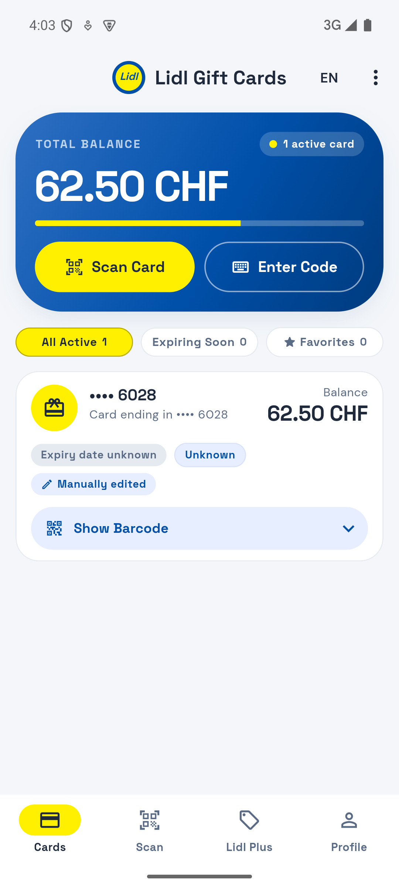
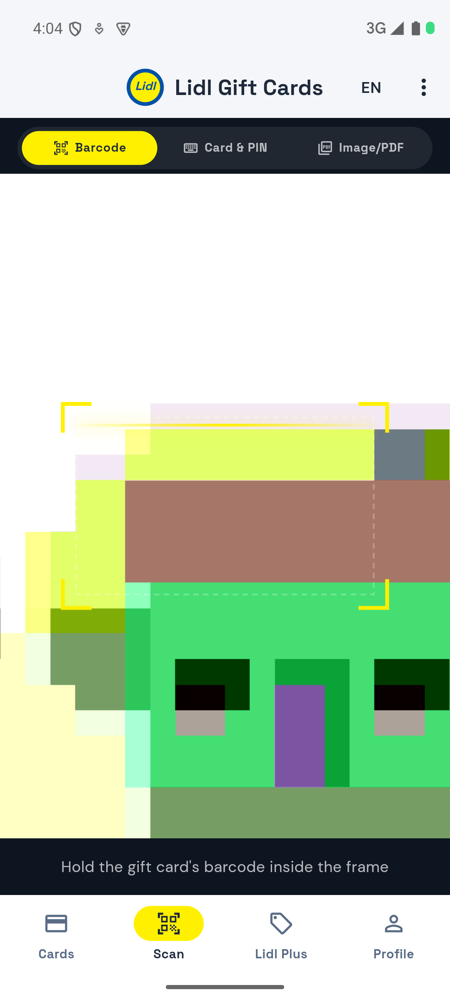
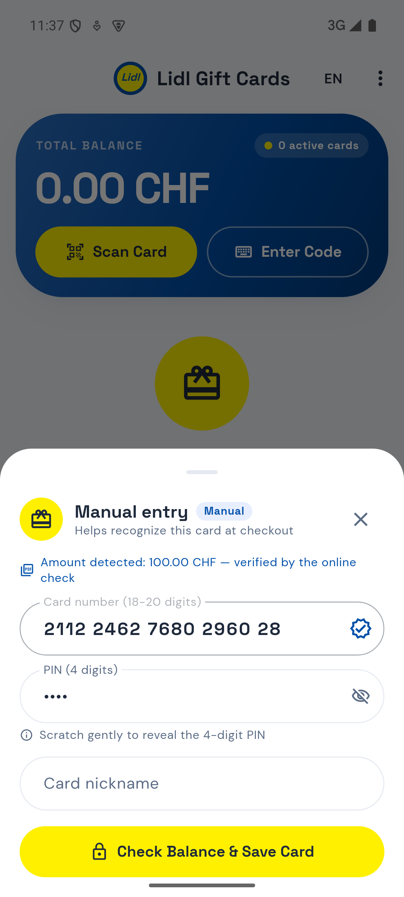
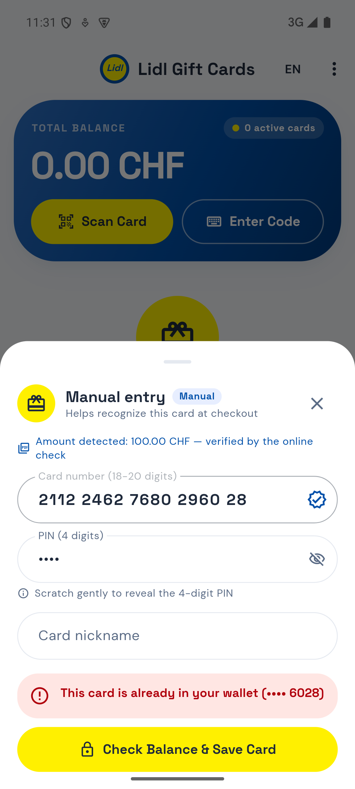
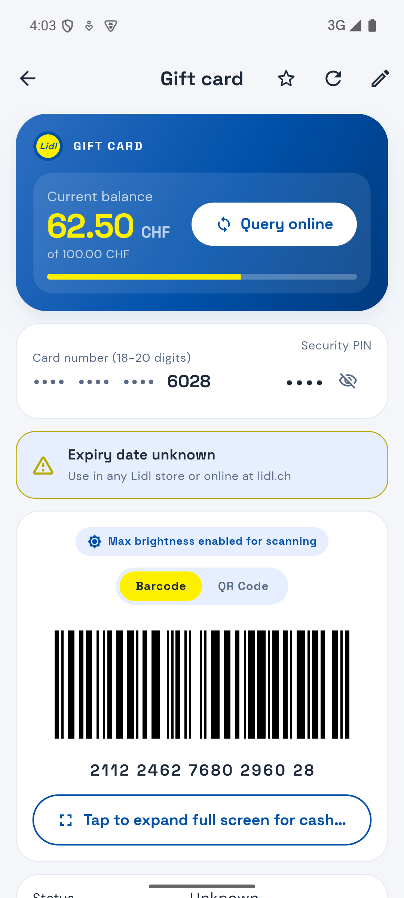
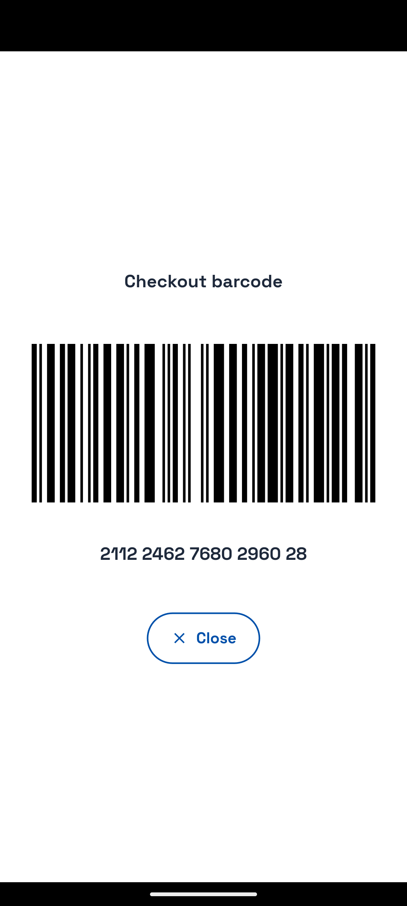
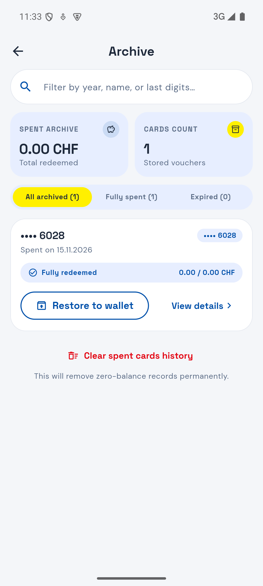
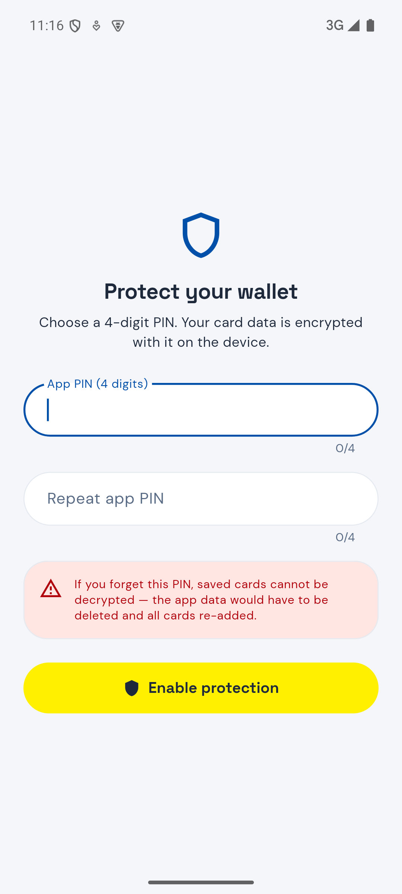

# Gift Card Wallet

> **Unofficial Lidl gift-card wallet intended strictly for personal use.** This independent
> app helps you manage your own Lidl Switzerland gift cards. It has no
> affiliation with or endorsement from Lidl. See [NOTICE](NOTICE).

[](LICENSE)


A local-first Android wallet for **Lidl Switzerland gift cards** (Geschenkkarten /
Einkaufsgutscheine). Scan the card or import the voucher PDF, keep the card
number and PIN **encrypted on your own device**, and query the remaining
balance from Lidl's official balance-check page with one tap.

These emulator screenshots show an earlier build of the unofficial wallet
with sample balances and a fully redeemed test card owned by the author.

| Wallet | Scan | PDF import | Duplicate guard |
|---|---|---|---|
|  |  |  |  |

| Card detail | Checkout barcode | Archive | PIN protection |
|---|---|---|---|
|  |  |  |  |

## Why this app exists

Lidl CH vouchers arrive as PDFs with a card number, a scratch PIN and a
barcode. To check each balance on the website, you enter the card number
and PIN. This app keeps your own cards in one place and lets you check
their balances without re-entering those details.

- **Nothing leaves the phone** except the balance query itself, which your
  device performs directly against Lidl's public page.
- The database is **encrypted at rest** under a PIN you choose (see
  [Security](#security-app-pin--encryption-at-rest)).

## Features

- **4-tab shell** — Cards (wallet), Scan, Balance (manual balance-check
  hub), Profile (language, stats, PIN security, data cleanup).
- **Wallet** — total balance hero with a remaining-value progress bar,
  filter chips (All Active / Expiring Soon / Favorites), card tiles, and an
  archived-cards link.
- **Three ways to add a card**
  - *Camera scan* — live barcode detection (bare numbers **and** the
    GS1-128 element strings real vouchers carry: `01` GTIN + `90` card
    number).
  - **PDF import** — pick the voucher PDF; the app reads the text layer
    (card number, PIN, face value, serial) with a pure-Dart extractor —
    no OCR, no native PDF dependency. Picking a file pauses the app and
    locks the wallet; the import replays automatically after the next
    unlock.
  - *Manual entry* — grouped 18–20-digit field with paste helper, PIN
    reveal, nickname, and a drawn "back of card" helper.
- **Check before save** — the entry sheet queries the balance first and
  stores the verified amount, status and expiry. If the query fails (see
  [How the balance fetch works](#how-the-balance-fetch-works)), you can
  still save the card — the PDF-detected face value seeds the progress bar.
- **Duplicate protection** — a card number that is already in the wallet is
  detected instantly (before any network call) and never stored twice.
- **Checkout view** — barcode/QR toggle, fullscreen cashier barcode at
  maximum screen brightness, PIN reveal, expiry warning banner.
- **Activity log** — activation, spend/reload deltas from refreshes, manual
  edits; per-card history with a bottom-sheet detail view.
- **Archive** — spent and expired cards move out of the wallet automatically
  (spend = a confirmed 0.00 sync); search, stats, restore, delete.
- **Refresh queue** — "Refresh all" walks every refreshable card through the
  hidden balance check, earliest expiry first.
- **CAPTCHA failsafe** — if the automatic check stalls, a red banner opens
  Lidl's balance page visibly for that card, and the Balance tab offers
  the same at any time.
- **English & German** — ships with both locales plus an in-app EN/DE
  toggle.

## How the balance fetch works

The app automates what you would do by hand on
[lidl.ch → Guthabenabfrage](https://www.lidl.ch/c/de-CH/guthabenabfrage-fuer-einkaufsgutscheine/s10077601)
inside a **hidden WebView**:

1. The page renders its form in the main frame (Vue component
   `AGiftyBalanceCheck`); the FriendlyCaptcha on the page **solves itself**
   by proof-of-work — it is designed to be invisible for humans, and the
   app simply waits for it.
2. A script finds the two inputs, fills card number and PIN, and clicks
   *JETZT ABFRAGEN*.
3. The JSON answer of `POST /explore/giftyBalanceV2/gifty` is captured by a
   fetch/XHR hook and parsed exactly; a regex fallback over the rendered
   page text (`200.00 CHF`, `Aktiv`, `31.10.2031`) covers page changes.

Parsing is layered and defensive: deep-search for balance/status/expiry
keys first, page-text fallback second. An experimental alternative that
posts the API request directly from Dart over `cronet_http` (Chrome's
network stack, for an identical TLS fingerprint) ships behind the
`kDirectApiEnabled` flag in `lib/services/balance_service.dart`.

### Known edge behavior (honest notes)

- Lidl's edge (Myra Security) occasionally serves a bot-challenge page
  instead of the form/answer — timing-dependent and IP-reputation-based.
  When that happens the app reports it and offers the visible fallback;
  retrying usually succeeds.
- The tx-gate fallback source
  (`balancechecks.tx-gate.com`) is geo-fenced and mainly works from
  Switzerland.
- This app performs the same requests the official page performs for every
  visitor. It does not bypass any protection: the captcha is still solved
  (by proof-of-work, as designed), and a challenge simply fails the query.
  Please be considerate — one refresh per card per day is plenty.

## Security: app PIN & encryption at rest

The wallet is protected by a mandatory **4-digit app PIN**:

- **First launch** asks for a PIN (entered twice). The PIN is never stored —
  only a random 16-byte salt and an encrypted verifier token live in the
  database.
- **Every app open and every return from the background** shows the PIN
  gate; no card data is read while locked.
- **Encryption at rest** — all sensitive columns (`cardNumber`, `pin`,
  `nickname`, `balance`, `initialBalance`, `currency`, `status`,
  `expiryDate`, `barcodeFormat`, `barcodeValue`, and the transaction log's
  `amount`/`balanceAfter`/`note`) are encrypted with **AES-256-GCM** under a
  key derived from the PIN (**PBKDF2-HMAC-SHA256**, 200 000 iterations,
  platform crypto with a pure-Dart fallback, KDF in a background isolate).
  Ciphertext is stored as `enc1:` + base64(nonce ‖ ciphertext ‖ MAC) with a
  fresh nonce per field.
- The derived key exists **only in memory** while unlocked; locking drops
  it. **Change PIN** re-encrypts every row in one transaction. The SQLite
  file is excluded from Android cloud backups.
- Legacy plaintext rows are migrated on first-run setup (schema v1 → v5).

### Honest limits

A 4-digit PIN has 10 000 combinations; PBKDF2 makes offline guessing of a
stolen database file expensive but not impossible for a determined attacker.
This protects against casual access — not a targeted attack on a rooted
device, and not while unlocked. **There is no PIN recovery**: forgetting it
means the data cannot be decrypted; reinstall and re-add the cards (the
balances come back from the online check). A warning about this is shown
during setup.

## Build & run

Install [Mise](https://mise.jdx.dev/installing-mise.html), Python 3, and
the Android SDK with platform tools. Set `ANDROID_HOME` to the SDK directory.
The app supports Android API 24 and later. [`mise.toml`](mise.toml) pins
the Flutter SDK and JDK used locally and in CI.

```bash
mise install
mise exec -- flutter pub get --enforce-lockfile
tool/patch_inappwebview_proguard.sh        # see note below
tool/patch_cryptography_pbkdf2_thread.sh   # see note below
mise exec -- flutter analyze --no-pub
mise exec -- flutter test --no-pub
mise exec -- flutter build apk --debug --no-pub
adb install build/app/outputs/flutter-apk/app-debug.apk
```

GitHub Actions runs analysis, host tests, and the Android debug build for
pull requests to `main` and pushes to `main`.

### pub-cache patches

`flutter_inappwebview_android 1.1.3` uses
`getDefaultProguardFile('proguard-android.txt')`, which recent Android
Gradle Plugins reject. `tool/patch_inappwebview_proguard.sh` rewrites it to
`proguard-android-optimize.txt`. `cryptography_flutter 2.3.4` runs its
crypto (PBKDF2!) inside Android `onMethodCall` — i.e. on the **main
thread** — which freezes the UI for seconds and trips the ANR dialog on
cold-start unlock; `tool/patch_cryptography_pbkdf2_thread.sh` moves the
dispatch to a worker thread. Both scripts patch the dependency copies in
`PUB_CACHE`, which defaults to `~/.pub-cache`. Re-run them after repairing
the cache or downloading the packages again.

## Automated tests

Three layers, cheapest first — no manual device poking required:

1. **Host tests** — `flutter test` (100+ tests: parser, GS1 scan codes,
   Gifty API payload shapes, voucher-PDF extraction, model/DAO/crypto,
   schema migrations v1→v5, lock gate, import replay). No device needed.
2. **On-device integration test** — drives the real app on an emulator
   with the real database and crypto through a full journey (PIN setup →
   add the real voucher card → online check → save → duplicate blocked):

   ```bash
   flutter test integration_test/app_e2e_test.dart -d <device-id>
   ```

3. **adb smoke test** — drives the installed APK through the complete user
   journey *including the real system file picker* (PIN setup → PDF import
   → unlock → replayed sheet → online check → save → duplicate blocked).
   Assertions come from `E2E:` logcat markers (debug builds); screenshots
   and UI dumps of every step land in `build/e2e-artifacts/`:

   ```bash
   tool/e2e_smoke.sh [--build]
   ```

Real-card evidence lives in `test/fixtures/`: a fully redeemed voucher PDF
(shared with permission), its decoded GS1-128 barcode payload, the live API
answer, and the result-page text — all locked into unit tests.

**Verified on-device (November 2026):** both the debug and the release
APK complete the full journey — fresh-install PIN setup, PDF import
(text layer + embedded barcode image → GS1 payload decoded via ML Kit),
online balance check against Lidl's live API (verified save and the
failure/"Save anyway" path), archive, duplicate protection. Verified on
a **physical phone** (Galaxy S26 Ultra, Android 17, release build) over
5G: the live balance check succeeds from the mobile network. Remaining:
checkout scanning against a real cashier scanner is the only acceptance
test that needs a store visit. Note that Lidl's edge occasionally
challenges individual clients/IPs for a while — if a check fails, the
app offers the manual captcha flow, and retrying later usually works.

## Project layout

```
lib/
  main.dart                  # DB open, crypto bootstrap, PIN gate
  theme/app_theme.dart       # design system: colors, fonts, radii
  models/gift_card.dart      # model, status enum, archive/refresh lifecycle
  models/card_transaction.dart # activity-log entry
  db/database.dart           # sqflite schema v5, DAOs, encryption helpers
  services/crypto_service.dart # PIN-derived AES-GCM field encryption
  services/parser.dart       # CHF / status / date parsing (pure, tested)
  services/gifty_api.dart    # giftyBalanceV2 JSON parser (pure, shared)
  services/gifty_api_client.dart # direct Cronet POST (plan B, flag-gated)
  services/voucher_codes.dart # GS1-128 / bare scan-code decoding
  services/voucher_pdf.dart  # voucher PDF text-layer extractor (pure Dart)
  services/balance_service.dart # hidden WebView, sources, fetch hook, queue
  state/providers.dart       # Riverpod: lock state, cards, totals, queue
  screens/                   # lock gate, home shell, wallet, scan, archive,
                             # card detail/checkout, manual check, profile
  widgets/                   # hero balance card, card tile, barcode view,
                             # Lidl badge, captcha banner
test/                        # 100+ unit & widget tests
integration_test/            # on-device end-to-end journey
tool/                        # pub-cache patches + adb e2e smoke test
screenshots/                 # the images above
```

## Privacy

The app stores your card data **only on your device**, encrypted (see
above). The balance query talks directly to `www.lidl.ch` from your device
— there is no intermediate server, no analytics, no tracking, no network
access by the authors. Remove the app and everything is gone.

## Disclaimer & legal

- **For personal use only.** Gift Card Wallet is an independently built,
  unofficial app for managing your own gift cards. "Lidl" and all related marks
  are trademarks of their respective owners, referenced here only to
  describe compatibility. No endorsement is implied.
- The app automates the *public* balance-check page and performs the same
  requests your browser performs; it does not circumvent captchas or other
  protections. Use it responsibly and within Lidl's terms of service.
- Gift cards remain the responsibility of Lidl; this tool only mirrors
  what the official balance check reports. The authors accept no liability
  for incorrect balances, lost cards, or any consequence of using this
  tool.
- No warranty. This software is provided "AS IS" — see [LICENSE](LICENSE).

## Contributing

You can fork the repository and open a pull request. The repository owner
reviews and merges changes to `main`.

## License

[Apache License 2.0](LICENSE) — © 2026 the Gift Card Wallet
contributors. Third-party components and trademark notices: see
[NOTICE](NOTICE).
